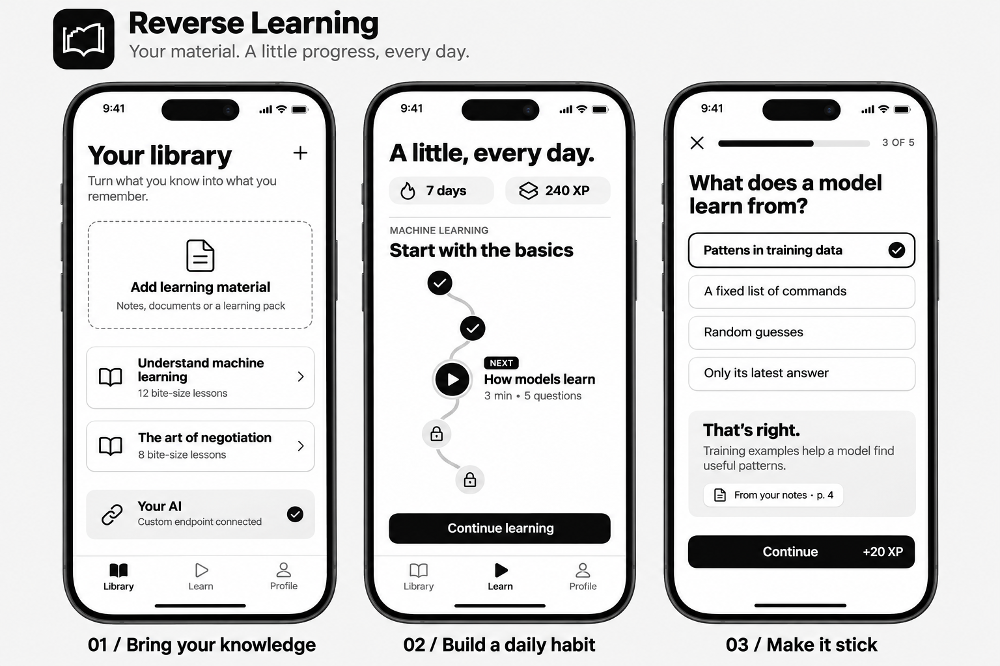

# Reverse Learning

An early iPhone app concept for turning your own learning material into short, playful lessons using your own AI provider.

**Status: visual PoC + offline SwiftUI starter.** Import, live AI generation, saved progress, and secure endpoint settings are planned; the starter currently loads one bundled pack and runs multiple-choice lessons locally.



## The idea

Bring notes or documents, connect your own LLM endpoint, and generate a structured learning pack. Learn in three-minute sessions with a lesson path, explanations tied to source material, and XP. Importing a prebuilt pack should also work without AI.

The visual direction is monochrome: white surfaces, black actions, quiet gray borders, and simple icons. The supplied concept is an AI-generated design exploration; the native starter is a smaller implementation, not a pixel-identical reproduction. Dashmigo's original assets were unavailable, so the design follows the described black-and-white direction.

## Run the iPhone starter

Requires full Xcode with iOS 17+ SDK and [XcodeGen](https://github.com/yonaskolb/XcodeGen).

```sh
cd ios
xcodegen generate
open ReverseLearning.xcodeproj
```

Select an iPhone simulator and run. Device signing requires your own development team. The app does not contact a network service or require an API key.

## Create a learning pack

Use [the JSON Schema](schemas/learning-pack.schema.json), [the sample pack](examples/machine-learning.learning.json), and [the format guide](docs/learning-pack.md). Version 1 supports text instruction and single-answer multiple-choice questions. It rejects unknown properties and requires source citations, explanations, stable IDs, and explicit order.

```sh
python3 -m venv .venv
.venv/bin/pip install -r requirements-dev.txt
.venv/bin/python scripts/validate_pack.py examples/machine-learning.learning.json
```

The validator checks JSON Schema plus ID uniqueness, references, answers, and sequence. The demo uses the bundled validated sample; validation of arbitrary imported files remains future work.

## Architecture and next steps

- SwiftUI app with local quiz flow and session XP in `ios/ReverseLearning`.
- Provider-neutral content format in `schemas` and `examples`.
- [AI endpoint contract and generation prompt](docs/ai-endpoint.md).
- [Product scope and roadmap](docs/product.md).

No provider credentials, user documents, or private project assets belong in this public repository.

## Validation

The sample pack is checked by CI. Xcode compilation and simulator visual QA require full Xcode; they were not available in the initial authoring environment.

## License

MIT. Supply only material you have permission to use. Generated content should be reviewed before learning or sharing it.
